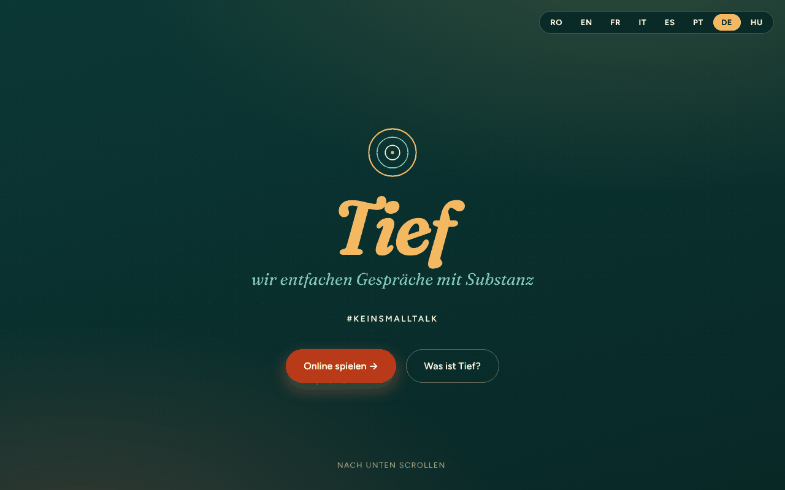

# Profund

[English](README.md) · [Română](README.ro.md) · [Français](README.fr.md) · [Italiano](README.it.md) · [Español](README.es.md) · [Português](README.pt.md) · **Deutsch** · [Magyar](README.hu.md)

**Version:** 2.0.1 · **Zuletzt aktualisiert:** 2026-10-27

Oberflächensprachen: **Română, English, Français, Italiano, Español, Português (PT), Deutsch, Magyar**

Ein „Trade-free“-Fragenspiel (ohne Handel) für Gespräche mit Tiefgang — #FaraVorbeGoale (#KeinSmalltalk).

**Online-App:** https://chiuta.github.io/Profund/

## Was es ist

Profund ist ein Spiel mit 150 Karten voller Fragen, die Gespräche eröffnen, in einer einzigen HTML-Datei. Der Text der App beschreibt es als rumänisch / englisch / französische Adaption nach deepcards.org, einem Projekt aus dem TROM-Ökosystem. Man kann es online spielen (Karten, die sich per Klick umdrehen) oder offline mit gedruckten Karten.

## Funktionen

- Oberfläche in 8 Sprachen (Schaltflächen RO / EN / FR / IT / ES / PT / DE / HU); die 150 Fragen gibt es auf Rumänisch, Englisch und Französisch (die anderen Sprachen zeigen die englische Fassung).
- Vorstellung: was das Spiel ist, seine drei Ideen und was passieren könnte.
- Vier beschriebene Spielmodi: „Ia & Răspunde“ (Nimm & antworte, 2–6 Personen), „Ghicește“ (Rate, 2–6), „Declanșator de conversații“ (Gesprächsauslöser, 4–20), „FărăRăspuns – TreciLaAcțiune“ (Ohne Antwort – Geh zur Tat über, 2–10).
- Online-Spiel: Die Fragen sind in Blöcken zu je 10 angeordnet; ein Klick auf eine Karte dreht sie um. Schaltflächen „Carte la întâmplare“ (Zufällige Karte), „Amestecă pachetul“ (Stapel mischen), „Următoarea carte“ (Nächste Karte).
- Spieler (optional, nur im Arbeitsspeicher): Du gibst die Namen durch Kommas getrennt ein, und jede gezogene Karte zeigt der Reihe nach, wer antwortet.
- Tastenkürzel im Bereich „Joacă online“ (Online spielen): `Leertaste` oder `→` = nächste Karte, `R` = zufällige Karte, `S` = mischen (nicht aktiv außerhalb des Spielbereichs oder in Textfeldern).
- Favoriten und Timer (im Bereich „Joacă online“): „♡ Păstrează cartea“ (Karte behalten) markiert die gezogene Karte, und „Descarcă favoritele (text)“ (Favoriten herunterladen (Text)) speichert die Liste als `profund-favorite.txt`; die Favoriten existieren nur im Arbeitsspeicher, bis die Seite neu geladen wird. Der optionale Timer (30 / 60 / 120 s) startet bei jeder gezogenen Karte und zeigt am Ende „Timpul a expirat.“ (Die Zeit ist abgelaufen.) an (ohne Ton). Texte auf RO / EN / FR.
- Offline-Spiel: „Printează cărțile (PDF)“ (Karten drucken (PDF); 150 Karten, 3 pro Zeile, zum Ausschneiden bereit) und „Descarcă întrebările (text)“ (Fragen herunterladen (Text)).
- Kontaktformular, das eine E-Mail (mailto) an den Autor vorbereitet.

## Anleitung

1. Wähle die Sprache mit den Schaltflächen RO / EN / FR / IT / ES / PT / DE / HU oben.
2. Lies den Abschnitt „Moduri de joc“ (Spielmodi) und wähle einen aus.
3. Unter „Joacă online“ drückst du „Carte la întâmplare“ für eine Karte, „Amestecă pachetul“ zum Mischen und dann „Următoarea carte“. Wenn der Stapel aufgebraucht ist, mische erneut.
4. Für das physische Spiel drückst du unter „Joacă offline“ auf „Printează cărțile (PDF)“, wählst „Als PDF speichern“ oder druckst, und schneidest die Karten dann aus.
5. „Descarcă întrebările (text)“ speichert die Fragen in einer Textdatei.
6. Unter „Contact“ füllst du Name, E-Mail, Betreff und Nachricht aus und drückst „Trimite mesajul“ (Nachricht senden): Dein E-Mail-Programm öffnet sich mit einer Nachricht an alexio@trom.tf (die App hat keinen Server).

## Datenschutz und Netzwerk

- Lokal: Nur die gewählte Sprache wird gespeichert, im `localStorage` (Schlüssel `profund_lang`).
- Netzwerk: Ich habe keine `fetch`-Aufrufe und keine externen Skripte oder Schriften gefunden (die Schriften sind in die Datei eingebettet). Der Text der App besagt „kein Geld, keine Daten“.
- Die Links in der Fußzeile und die Unterstützungslinks (deepcards.org, tiotrom.com, trade-free.org, Buy Me a Coffee) öffnen sich nur, wenn du sie anklickst.
- Das Kontaktformular sendet keine Daten über einen Server; es verwendet `mailto:`.

## Lokal / offline ausführen

Lade `index.html` herunter und öffne sie in einem Browser; sie funktioniert ohne Internet (externe Links benötigen eine Verbindung).

## Verlauf / Changelog

### 1.2.4 — 2026-10-22

fff-kit 1.1.4: Touch-Ziele und Mindestschriftgröße.

### 1.2.3 — 2026-10-22
- fff-kit 1.1.2: PBKDF2 mit 600.000 Iterationen, Schutz vor Clickjacking

### 1.2.2 — 2026-10-22

Feinschliff für Mobilgeräte und Barrierefreiheit: Text mit mindestens 12 px und Touch-Ziele von mindestens 24 px. sichtbarer Tastaturfokus bei jedem Steuerelement.

### 1.1.0 — 2026-10-14
- Sicherung und Kennzeichnung der Daten (fff-kit).

### 12. Oktober 2026 (v1.0.0)
- 1.0.0 — 2026-10-12: Die Version und das Datum der letzten Aktualisierung werden in der App angezeigt

### 11. Oktober 2026 (dritter Eintrag)
- Der Titel des Modus auf Englisch wurde korrigiert: „LetGuess“ → „Guess“ (wie „Ghicește“ auf Rumänisch und „Devine“ auf Französisch).
- Favoriten (als Text herunterladbar) und optionaler Timer pro Karte, in 3 Sprachen.

### 11. Oktober 2026 (zweiter Eintrag)
- CSP: `script-src` mit Hash statt `'unsafe-inline'` (es gibt keine Inline-Attribute `on*` mehr).
- Optionales Feld „Spieler“ (die Zeile des antwortenden Spielers auf der gezogenen Karte) und Tastenkürzel; neue Texte auf RO / EN / FR.

### 11. Oktober 2026
- Barrierefreiheit: Inhalt in <main> eingefasst, Sprachauswahl als beschriftetes <nav> (axe: 0 Verstöße).
- Die Schaltflächen RO / EN / FR verwenden keine Inline-Attribute `onclick` mehr (Event-Listener).

## Lizenz

MIT-Lizenz — siehe die Datei LICENSE

## Rechte und Namensnennung

- **Anteil des Autors:** der Code der Anwendung und der originale Beitrag (die Adaption, die Übersetzungen RO/EN/FR, die Oberfläche). Die MIT-Lizenz im Header von `index.html` und in `LICENSE` gilt **nur** für diesen Anteil.
- **Anteil Dritter:** Die Fragen sind dem Kartenspiel [deepcards.org](https://deepcards.org/) nachempfunden (ein Projekt aus dem TROM-Ökosystem; die App weist im Untertitel und in der Fußzeile darauf hin). Die Originale verbleiben bei ihren Rechteinhabern; **die MIT-Lizenz erstreckt sich nicht auf sie**. Die Rechte an Materialien Dritter liegen bei ihren Inhabern. Die Lizenz der Originale ist in diesem Repository nicht geprüft.
- **Berichtigung / Rücknahme:** Wenn du Rechteinhaber oder eine erwähnte Person bist und eine Berichtigung oder Rücknahme wünschst, schreibe an alexio@trom.tf; wir antworten innerhalb von 7 Tagen.
- Der Hinweis ist auch in der App sichtbar (Fußzeile, RO / EN / FR).

**UNGEKLÄRT (nur der Autor):** die Bestätigung, dass er das Recht hat (oder erhalten hat), die adaptierten Fragen in dieser Form zu veröffentlichen, oder die Angabe der Lizenz der Originale von deepcards.org.

## Autor

Alexio — Alexandru-Ionuț Chiuță, Kontakt: alexio@trom.tf. Die App erwähnt ihn als TROM-Freiwilligen.

## Zusammenfassung

Profund („Tiefe“) ist ein markenfreies Fragenkartenspiel in einer einzigen Datei (150 Karten) für bedeutungsvolle Gespräche, auf Rumänisch, Englisch und Französisch. Es bietet vier Spielweisen, eine optionale Spielerliste (nur im Arbeitsspeicher), die anzeigt, wer als Nächstes antworten muss, Tastenkürzel, ein Online-Kartendeck, Karten zum Drucken als PDF und einen Textdownload. Nur die gewählte Sprache wird in localStorage gespeichert; es wurden keine externen Anfragen gefunden, und das Kontaktformular nutzt mailto. Adaptiert von deepcards.org. Die MIT-Lizenz gilt nur für den Code und den eigenen Beitrag des Autors; die ursprünglichen Fragen verbleiben bei ihren Rechteinhabern. Anfragen auf Berichtigung/Rücknahme: alexio@trom.tf (Antwort innerhalb von 7 Tagen).
