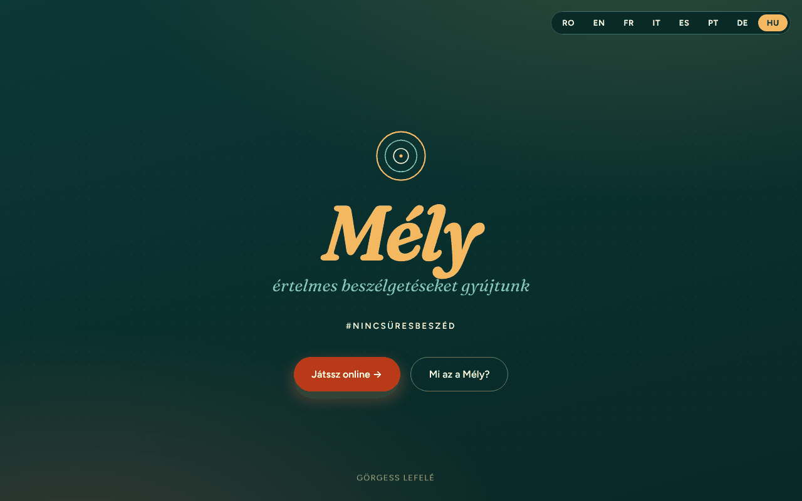

# Profund

[English](README.md) · [Română](README.ro.md) · [Français](README.fr.md) · [Italiano](README.it.md) · [Español](README.es.md) · [Português](README.pt.md) · [Deutsch](README.de.md) · **Magyar**

**Verzió:** 1.2.4 · **Utolsó frissítés:** 2026-10-22

A felület nyelvei: **Română, English, Français, Italiano, Español, Português (PT), Deutsch, Magyar**

„Trade-free” (kereskedelemmentes) kérdezős játék tartalmas beszélgetésekhez — #FaraVorbeGoale (#NincsÜresBeszéd).

**Online alkalmazás:** https://chiuta.github.io/Profund/

## Mi ez

A Profund egy 150 kártyából álló játék beszélgetéseket megnyitó kérdésekkel, egyetlen HTML-fájlban. Az alkalmazás szövege román / angol / francia adaptációként írja le a deepcards.org nyomán, amely a TROM-ökoszisztéma egyik projektje. Játszható online (megérintésre megfordulő kártyákkal) vagy offline, kinyomtatott kártyákkal.

## Funkciók

- 8 nyelvű felület (RO / EN / FR / IT / ES / PT / DE / HU gombok); a 150 kérdés románul, angolul és franciául létezik (a többi nyelven az angol változat látható).
- Bemutató: mi a játék, a három alapgondolata, és mi történhet.
- Négy leírt játékmód: „Ia & Răspunde” (Húzz és válaszolj, 2–6 fő), „Ghicește” (Találd ki, 2–6), „Declanșator de conversații” (Beszélgetésindító, 4–20), „FărăRăspuns – TreciLaAcțiune” (Válasz nélkül – Térj át a cselekvésre, 2–10).
- Online játék: a kérdések 10-es blokkokban vannak; egy kártyára kattintva megfordítod. Gombok: „Carte la întâmplare” (Véletlen kártya), „Amestecă pachetul” (Pakli keverése), „Următoarea carte” (Következő kártya).
- Játékosok (nem kötelező, csak a memóriában): vesszővel elválasztva beírod a neveket, és minden húzott kártya sorban megmutatja, ki válaszol.
- Billentyűparancsok a „Joacă online” (Játék online) területen: `Szóköz` vagy `→` = következő kártya, `R` = véletlen kártya, `S` = keverés (a játékterületen kívül és szövegmezőkben nem aktívak).
- Kedvencek és időzítő (a „Joacă online” területen): a „♡ Păstrează cartea” (Kártya megtartása) megjelöli a húzott kártyát, a „Descarcă favoritele (text)” (Kedvencek letöltése (szöveg)) pedig `profund-favorite.txt` néven menti a listát; a kedvencek csak a memóriában léteznek, az oldal újratöltéséig. A nem kötelező időzítő (30 / 60 / 120 mp) minden húzott kártyánál elindul, és a végén kiírja: „Timpul a expirat.” (Lejárt az idő.) (hang nélkül). A szövegek RO / EN / FR nyelven.
- Offline játék: „Printează cărțile (PDF)” (Kártyák nyomtatása (PDF); 150 kártya, soronként 3, kivágásra készen) és „Descarcă întrebările (text)” (Kérdések letöltése (szöveg)).
- Kapcsolati űrlap, amely e-mailt (mailto) készít elő a szerzőnek.

## Használati útmutató

1. Válaszd ki a nyelvet a felül lévő RO / EN / FR / IT / ES / PT / DE / HU gombokkal.
2. Olvasd el a „Moduri de joc” (Játékmódok) szakaszt, és válassz egyet.
3. A „Joacă online” alatt a „Carte la întâmplare” gombbal húzol egy kártyát, az „Amestecă pachetul” gombbal keversz, majd jöhet a „Următoarea carte”. Ha elfogy a pakli, keverd meg újra.
4. Fizikai játékhoz a „Joacă offline” alatt nyomd meg a „Printează cărțile (PDF)” gombot, válaszd a „Mentés PDF-ként” lehetőséget, vagy nyomtass, majd vágd ki a kártyákat.
5. A „Descarcă întrebările (text)” szövegfájlba menti a kérdéseket.
6. A „Contact” résznél kitöltöd a nevedet, az e-mail-címedet, a tárgyat és az üzenetet, majd megnyomod a „Trimite mesajul” (Üzenet küldése) gombot: megnyílik az e-mail-kliensed egy alexio@trom.tf címre szóló üzenettel (az alkalmazásnak nincs szervere).

## Adatvédelem és hálózat

- Helyi: csak a kiválasztott nyelv tárolódik a `localStorage`-ban (kulcs: `profund_lang`).
- Hálózat: nem találtam `fetch` hívásokat, sem külső szkripteket vagy betűtípusokat (a betűtípusok be vannak építve a fájlba). Az alkalmazás szövege azt állítja: „nincs pénz, nincsenek adatok”.
- A lábléc linkjei és a támogatói linkek (deepcards.org, tiotrom.com, trade-free.org, Buy Me a Coffee) csak akkor nyílnak meg, ha rájuk kattintasz.
- A kapcsolati űrlap nem küld adatot szerveren keresztül; `mailto:`-t használ.

## Helyi / offline futtatás

Töltsd le az `index.html` fájlt, és nyisd meg egy böngészőben; internet nélkül is működik (a külső linkekhez kapcsolat kell).

## Előzmények / Changelog

### 1.2.4 — 2026-10-22

fff-kit 1.1.4: érintési célok és minimális szövegméret.

### 1.2.3 — 2026-10-22
- fff-kit 1.1.2: PBKDF2 600 000 iterációval, clickjacking elleni védelem

### 1.2.2 — 2026-10-22

mobil és kisegítő finomítások: legalább 12 px-es szöveg és legalább 24 px-es érintési felületek. látható billentyűzetfókusz minden vezérlőn.

### 1.1.0 — 2026-10-14
- Biztonsági mentés és adatcímkézés (fff-kit).

### 2026. október 12. (v1.0.0)
- 1.0.0 — 2026-10-12: a verzió és az utolsó frissítés dátuma megjelenik az alkalmazásban

### 2026. október 11. (harmadik bejegyzés)
- Javítva az angol nyelvű játékmód címe: „LetGuess” → „Guess” (mint a románban a „Ghicește” és a franciában a „Devine”).
- Kedvencek (szövegként letölthetők) és nem kötelező kártyánkénti időzítő, 3 nyelven.

### 2026. október 11. (második bejegyzés)
- CSP: `script-src` hash-sel az `'unsafe-inline'` helyett (már nincsenek beágyazott `on*` attribútumok).
- Nem kötelező „Játékosok” mező (a válaszoló játékos sora a húzott kártyán) és billentyűparancsok; új szövegek RO / EN / FR nyelven.

### 2026. október 11.
- Akadálymentesség: a tartalom <main> elembe foglalva, a nyelvválasztó címkézett <nav> elemként (axe: 0 szabálysértés).
- Az RO / EN / FR gombok már nem használnak beágyazott `onclick` attribútumokat (eseményfigyelők).

## Licenc

MIT licenc — lásd a LICENSE fájlt

## Jogok és forrásmegjelölés

- **A szerző része:** az alkalmazás kódja és az eredeti hozzájárulás (az adaptáció, az RO/EN/FR fordítások, a felület). Az `index.html` fejlécében és a `LICENSE` fájlban szereplő MIT licenc **kizárólag** erre a részre vonatkozik.
- **Harmadik felek része:** a kérdések a [deepcards.org](https://deepcards.org/) kártyajáték alapján készültek (a TROM-ökoszisztéma projektje; az alkalmazás az alcímben és a láblécben jelzi). Az eredetik jogtulajdonosaiknál maradnak; **az MIT licenc nem terjed ki rájuk**. A harmadik felek anyagaihoz fűződő jogok a tulajdonosaikat illetik. Az eredetik licencét ebben a tárolóban nem ellenőriztük.
- **Helyreigazítás / visszavonás:** ha jogtulajdonos vagy megemlített személy vagy, és helyreigazítást vagy visszavonást szeretnél, írj az alexio@trom.tf címre; 7 napon belül válaszolunk.
- A közlemény az alkalmazásban is látható (lábléc, RO / EN / FR).

**MEGOLDATLAN (csak a szerző):** annak megerősítése, hogy jogosult (vagy jogot szerzett) az adaptált kérdéseket ebben a formában közzétenni, illetve a deepcards.org eredeti anyagai licencének megjelölése.

## Szerző

Alexio — Alexandru-Ionuț Chiuță, elérhetőség: alexio@trom.tf. Az alkalmazás TROM-önkéntesként említi.

## Összefoglaló
A Profund („Mély”) egyfájlos, trade-free kérdéskártyás játék (150 kártya) tartalmas beszélgetésekhez, románul, angolul és franciául. Négy játékmódot kínál, opcionális (csak memóriában élő) játékoslistát, amely megmutatja, kinek kell válaszolnia, billentyűparancsokat, online kártyapaklit, PDF-be nyomtatható kártyákat és szöveges letöltést. Csak a választott nyelv tárolódik a localStorage-ban; külső kéréseket nem találtunk, a kapcsolatfelvételi űrlap mailto-t használ. A deepcards.org alapján átdolgozva. Az MIT licenc csak a kódra és a szerző saját hozzájárulására vonatkozik; az eredeti kérdések jogtulajdonosaiknál maradnak. Helyesbítési/visszavonási kérelmek: alexio@trom.tf (válasz 7 napon belül).
