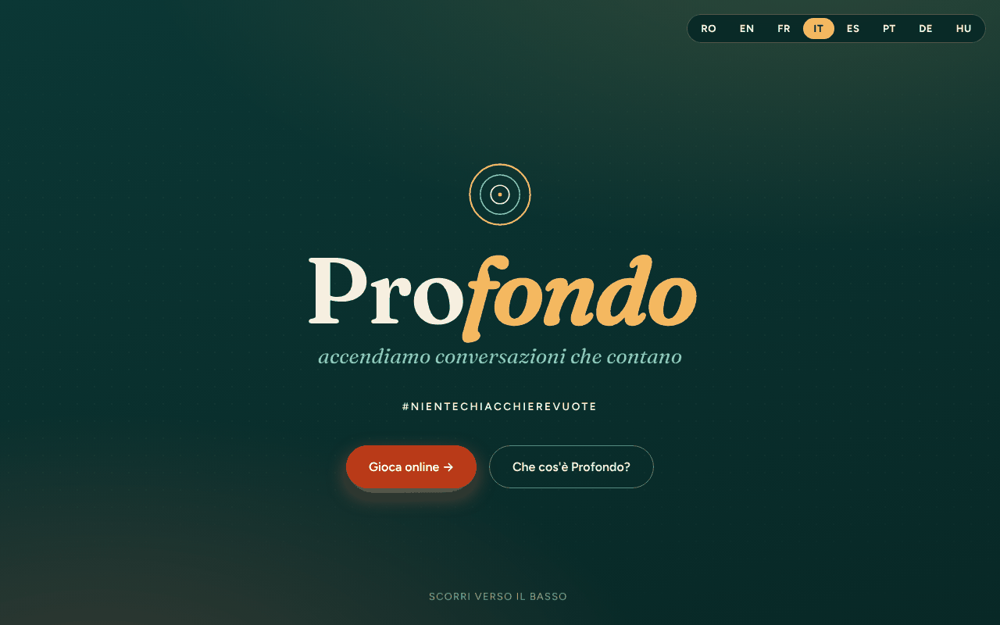

# Profund

[English](README.md) · [Română](README.ro.md) · [Français](README.fr.md) · **Italiano** · [Español](README.es.md) · [Português](README.pt.md) · [Deutsch](README.de.md) · [Magyar](README.hu.md)

**Versione:** 1.2.3 · **Ultimo aggiornamento:** 2026-10-22

Lingue dell'interfaccia: **Română, English, Français, Italiano, Español, Português (PT), Deutsch, Magyar**

Un gioco di domande «trade-free» (senza scambio commerciale) per conversazioni che abbiano senso — #FaraVorbeGoale (#NienteChiacchiereVuote).

**App online:** https://chiuta.github.io/Profund/

## Che cos'è

Profund è un gioco di 150 carte con domande che aprono conversazioni, in un unico file HTML. Il testo dell'app lo descrive come un adattamento rumeno / inglese / francese da deepcards.org, un progetto dell'ecosistema TROM. Si può giocare online (carte che si girano con un tocco) oppure offline, con carte stampate.

## Funzioni

- Interfaccia in 8 lingue (pulsanti RO / EN / FR / IT / ES / PT / DE / HU); le 150 domande esistono in rumeno, inglese e francese (le altre lingue mostrano la versione inglese).
- Presentazione: che cos'è il gioco, le sue tre idee e che cosa potrebbe succedere.
- Quattro modalità di gioco descritte: «Ia & Răspunde» (Prendi e rispondi, 2–6 persone), «Ghicește» (Indovina, 2–6), «Declanșator de conversații» (Innesco di conversazioni, 4–20), «FărăRăspuns – TreciLaAcțiune» (Senza risposta – Passa all'azione, 2–10).
- Gioco online: le domande sono in blocchi da 10; premi una carta per girarla. Pulsanti «Carte la întâmplare» (Carta a caso), «Amestecă pachetul» (Mescola il mazzo), «Următoarea carte» (Carta successiva).
- Giocatori (facoltativo, solo in memoria): scrivi i nomi separati da virgole e ogni carta pescata mostra, a turno, chi risponde.
- Scorciatoie da tastiera nell'area «Joacă online» (Gioca online): `Spazio` o `→` = carta successiva, `R` = carta a caso, `S` = mescola (non attive fuori dall'area di gioco o nei campi di testo).
- Preferiti e timer (nell'area «Joacă online»): «♡ Păstrează cartea» (Tieni la carta) contrassegna la carta pescata, e «Descarcă favoritele (text)» (Scarica i preferiti (testo)) salva l'elenco come `profund-favorite.txt`; i preferiti esistono solo in memoria, fino al ricaricamento della pagina. Il timer facoltativo (30 / 60 / 120 s) parte a ogni carta pescata e mostra «Timpul a expirat.» (Il tempo è scaduto.) alla fine (senza suono). Testi in RO / EN / FR.
- Gioco offline: «Printează cărțile (PDF)» (Stampa le carte (PDF); 150 carte, 3 per riga, pronte da ritagliare) e «Descarcă întrebările (text)» (Scarica le domande (testo)).
- Modulo di contatto che prepara un'e-mail (mailto) all'autore.

## Guida all'uso

1. Scegli la lingua con i pulsanti RO / EN / FR / IT / ES / PT / DE / HU in alto.
2. Leggi la sezione «Moduri de joc» (Modalità di gioco) e scegline una.
3. In «Joacă online» premi «Carte la întâmplare» per una carta, «Amestecă pachetul» per mescolare, poi «Următoarea carte». Quando il mazzo finisce, mescola di nuovo.
4. Per il gioco fisico, in «Joacă offline» premi «Printează cărțile (PDF)», scegli «Salva come PDF» oppure stampa, poi ritaglia le carte.
5. «Descarcă întrebările (text)» salva le domande in un file di testo.
6. In «Contact» compili nome, e-mail, oggetto e messaggio e premi «Trimite mesajul» (Invia il messaggio): si apre il tuo client di posta con un messaggio per alexio@trom.tf (l'app non ha un server).

## Privacy e rete

- Locale: viene conservata solo la lingua scelta, in `localStorage` (chiave `profund_lang`).
- Rete: non ho trovato chiamate `fetch`, né script o font esterni (i font sono incorporati nel file). Il testo dell'app afferma «niente soldi, niente dati».
- I link nel piè di pagina e quelli di sostegno (deepcards.org, tiotrom.com, trade-free.org, Buy Me a Coffee) si aprono solo se li premi.
- Il modulo di contatto non invia dati tramite un server; usa `mailto:`.

## Esecuzione in locale / offline

Scarica `index.html` e aprilo in un browser; funziona senza internet (i link esterni richiedono una connessione).

## Cronologia / Changelog

### 1.2.3 — 2026-10-22
- fff-kit 1.1.2: PBKDF2 con 600.000 iterazioni, protezione anti-clickjacking

### 1.2.2 — 2026-10-22

rifiniture per mobile e accessibilità: testo di almeno 12 px e aree tattili di almeno 24 px. focus da tastiera visibile su ogni controllo.

### 1.1.0 — 2026-10-14
- Copia di riserva ed etichettatura dei dati (fff-kit).

### 12 ottobre 2026 (v1.0.0)
- 1.0.0 — 2026-10-12: la versione e la data dell'ultimo aggiornamento sono mostrate nell'app

### 11 ottobre 2026 (terza voce)
- Corretto il titolo della modalità in inglese: «LetGuess» → «Guess» (come «Ghicește» in rumeno e «Devine» in francese).
- Preferiti (scaricabili come testo) e timer facoltativo per carta, in 3 lingue.

### 11 ottobre 2026 (seconda voce)
- CSP: `script-src` con hash al posto di `'unsafe-inline'` (non ci sono più attributi `on*` inline).
- Campo facoltativo «Giocatori» (la riga di chi risponde sulla carta pescata) e scorciatoie da tastiera; nuovi testi in RO / EN / FR.

### 11 ottobre 2026
- Accessibilità: contenuto racchiuso in <main>, selettore della lingua come <nav> etichettato (axe: 0 violazioni).
- I pulsanti RO / EN / FR non usano più attributi `onclick` inline (listener di eventi).

## Licenza

Licenza MIT — vedi il file LICENSE

## Diritti e attribuzione

- **Parte dell'autore:** il codice dell'applicazione e il contributo originale (l'adattamento, le traduzioni RO/EN/FR, l'interfaccia). La licenza MIT nell'intestazione di `index.html` e in `LICENSE` si applica **solo** a questa parte.
- **Parte di terzi:** le domande sono adattate dal gioco di carte [deepcards.org](https://deepcards.org/) (un progetto dell'ecosistema TROM; l'app lo indica nel sottotitolo e nel piè di pagina). Gli originali restano ai rispettivi titolari; **la licenza MIT non li copre**. I diritti sui materiali di terzi appartengono ai loro titolari. La licenza degli originali non è verificata in questo repository.
- **Rettifica / ritiro:** se sei un titolare di diritti o una persona menzionata e desideri una correzione o il ritiro, scrivi a alexio@trom.tf; rispondiamo entro 7 giorni.
- L'avviso è visibile anche nell'app (piè di pagina, RO / EN / FR).

**IRRISOLTO (solo l'autore):** conferma di avere (o di aver ottenuto) il diritto di pubblicare le domande adattate in questa forma, oppure indicazione della licenza degli originali di deepcards.org.

## Autore

Alexio — Alexandru-Ionuț Chiuță, contatto: alexio@trom.tf. L'app lo menziona come volontario TROM.

## Riepilogo

Profund («Profondo») è un gioco di carte con domande, in un unico file e trade-free (150 carte), per conversazioni significative, in rumeno, inglese e francese. Offre quattro modi di giocare, un elenco giocatori facoltativo (solo in memoria) che mostra a chi tocca rispondere, scorciatoie da tastiera, un mazzo di carte online, carte da stampare in PDF e un download di testo. In localStorage è memorizzata solo la lingua scelta; non sono state trovate richieste esterne e il modulo di contatto usa mailto. Adattato da deepcards.org. La licenza MIT si applica solo al codice e al contributo originale dell'autore; le domande originali restano ai rispettivi titolari dei diritti. Richieste di rettifica/ritiro: alexio@trom.tf (risposta entro 7 giorni).
