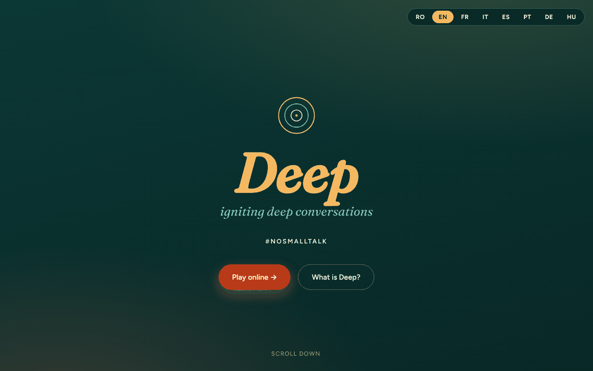

# Profund

**English** · [Română](README.ro.md) · [Français](README.fr.md) · [Italiano](README.it.md) · [Español](README.es.md) · [Português](README.pt.md) · [Deutsch](README.de.md) · [Magyar](README.hu.md)

**Version:** 1.2.0 · **Last updated:** 2026-10-19

Interface languages: **Română, English, Français, Italiano, Español, Português (PT), Deutsch, Magyar**

A "trade-free" question game for meaningful conversations — #FaraVorbeGoale (#NoSmallTalk).

**Live app:** https://chiuta.github.io/Profund/

## What it is

Profund is a game of 150 cards with questions that open up conversations, in a single HTML file. The text in the app describes it as a Romanian / English / French adaptation after deepcards.org, a project from the TROM ecosystem. It can be played online (cards that flip when pressed) or offline, with printed cards.

## Features

- Interface in 8 languages (RO / EN / FR / IT / ES / PT / DE / HU buttons); the 150 questions exist in Romanian, English and French (the other languages show the English version).
- Introduction: what the game is, its three ideas and what might happen.
- Four game modes described: "Ia & Răspunde" (Take & Answer, 2–6 people), "Ghicește" (Guess, 2–6), "Declanșator de conversații" (Conversation Starter, 4–20), "FărăRăspuns – TreciLaAcțiune" (No Answer – Go to Action, 2–10).
- Online play: the questions come in blocks of 10; you press a card to flip it. Buttons "Carte la întâmplare" (Random card), "Amestecă pachetul" (Shuffle the deck), "Următoarea carte" (Next card).
- Players (optional, in memory only): type the names separated by commas and each drawn card shows, in turn, who answers.
- Keyboard shortcuts in the "Joacă online" (Play online) area: `Space` or `→` = next card, `R` = random card, `S` = shuffle (not active outside the play area or in text fields).
- Favorites and timer (in the "Joacă online" area): "♡ Păstrează cartea" (Keep the card) marks the drawn card, and "Descarcă favoritele (text)" (Download favorites (text)) saves the list as `profund-favorite.txt`; favorites exist only in memory, until the page is reloaded. The optional timer (30 / 60 / 120 s) starts with each drawn card and shows "Timpul a expirat." (Time is up.) at the end (no sound). Texts in RO / EN / FR.
- Offline play: "Printează cărțile (PDF)" (Print the cards (PDF); 150 cards, 3 per row, ready to cut out) and "Descarcă întrebările (text)" (Download the questions (text)).
- Contact form that prepares an email (mailto) to the author.

## User guide

1. Choose the language with the RO / EN / FR / IT / ES / PT / DE / HU buttons at the top.
2. Read the "Moduri de joc" (Game modes) section and choose one.
3. Under "Joacă online", press "Carte la întâmplare" for a card, "Amestecă pachetul" to shuffle, then "Următoarea carte". When the deck runs out, shuffle again.
4. For physical play, under "Joacă offline" press "Printează cărțile (PDF)", choose "Save as PDF" or print, then cut out the cards.
5. "Descarcă întrebările (text)" saves the questions in a text file.
6. Under "Contact" you fill in your name, email, subject and message and press "Trimite mesajul" (Send the message): your email client opens with a message to alexio@trom.tf (the app has no server).

## Privacy and network

- Local: only the chosen language is kept, in `localStorage` (key `profund_lang`).
- Network: I found no `fetch` calls, external scripts or fonts (the fonts are embedded in the file). The text in the app states "no money, no data".
- The footer links and the support links (deepcards.org, tiotrom.com, trade-free.org, Buy Me a Coffee) open only if you press them.
- The contact form does not send data through a server; it uses `mailto:`.

## Running locally / offline

Download `index.html` and open it in a browser; it works without internet (external links need a connection).

## History / Changelog

### 1.1.0 — 2026-10-14
- Backup and data labeling (fff-kit).

### 12 October 2026 (v1.0.0)
- 1.0.0 — 2026-10-12: the version and the date of the last update are shown in the app

### 11 October 2026 (third entry)
- Fixed the English mode title: "LetGuess" → "Guess" (like "Ghicește" in Romanian and "Devine" in French).
- Favorites (downloadable as text) and an optional per-card timer, in 3 languages.

### 11 October 2026 (second entry)
- CSP: `script-src` with a hash instead of `'unsafe-inline'` (there are no more inline `on*` attributes).
- Optional "Players" field (the answering player's row on the drawn card) and keyboard shortcuts; new texts in RO / EN / FR.

### 11 October 2026
- Accessibility: content wrapped in <main>, language selector as a labeled <nav> (axe: 0 violations).
- The RO / EN / FR buttons no longer use inline `onclick` attributes (event listeners).

## License

MIT License — see the LICENSE file

## Rights and attribution

- **The author's part:** the application code and the original contribution (the adaptation, the RO/EN/FR translations, the interface). The MIT license in the `index.html` header and in `LICENSE` applies **only** to this part.
- **The third parties' part:** the questions are adapted from the card game [deepcards.org](https://deepcards.org/) (a project from the TROM ecosystem; the app points to it in the subtitle and in the footer). The originals remain with their rightsholders; **the MIT license does not cover them**. Rights in third-party materials belong to their holders. The license of the originals has not been verified in this repository.
- **Rectification / withdrawal:** if you are a rightsholder or a person mentioned and wish a correction or withdrawal, write to alexio@trom.tf; we reply within 7 days.
- The notice is also visible in the app (footer, RO / EN / FR).

**UNRESOLVED (author only):** confirmation that he has (or has obtained) the right to publish the adapted questions in this form, or indication of the license of the originals from deepcards.org.

## Author

Alexio — Alexandru-Ionuț Chiuță, contact: alexio@trom.tf. The app mentions him as a TROM volunteer.

## English summary

Profund ("Deep") is a single-file trade-free question card game (150 cards) for meaningful conversations, in Romanian, English and French. It offers four ways to play, an optional (memory-only) player list that shows whose turn it is to answer, keyboard shortcuts, an online card deck, print-to-PDF cards and a text download. Only the chosen language is stored in localStorage; no external requests were found, and the contact form uses mailto. Adapted from deepcards.org. The MIT License applies only to the code and the author's original contribution; the original questions remain with their rightsholders. Rectification/withdrawal requests: alexio@trom.tf (reply within 7 days).
