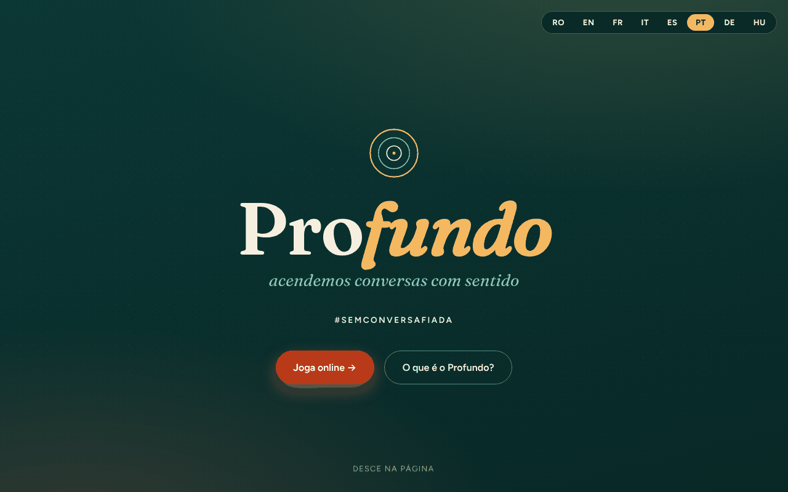

# Profund

[English](README.md) · [Română](README.ro.md) · [Français](README.fr.md) · [Italiano](README.it.md) · [Español](README.es.md) · **Português** · [Deutsch](README.de.md) · [Magyar](README.hu.md)

**Versão:** 1.2.5 · **Última atualização:** 2026-10-23

Idiomas da interface: **Română, English, Français, Italiano, Español, Português (PT), Deutsch, Magyar**

Um jogo de perguntas «trade-free» (sem troca comercial) para conversas com sentido — #FaraVorbeGoale (#SemConversaVazia).

**Aplicação online:** https://chiuta.github.io/Profund/

## O que é

O Profund é um jogo de 150 cartas com perguntas que abrem conversas, num único ficheiro HTML. O texto da aplicação descreve-o como uma adaptação romena / inglesa / francesa a partir de deepcards.org, um projeto do ecossistema TROM. Pode jogar-se online (cartas que se viram ao premir) ou offline, com cartas impressas.

## Funcionalidades

- Interface em 8 idiomas (botões RO / EN / FR / IT / ES / PT / DE / HU); as 150 perguntas existem em romeno, inglês e francês (os outros idiomas mostram a versão em inglês).
- Apresentação: o que é o jogo, as suas três ideias e o que poderá acontecer.
- Quatro modos de jogo descritos: «Ia & Răspunde» (Pega e responde, 2–6 pessoas), «Ghicește» (Adivinha, 2–6), «Declanșator de conversații» (Desencadeador de conversas, 4–20), «FărăRăspuns – TreciLaAcțiune» (Sem resposta – Passa à ação, 2–10).
- Jogo online: as perguntas estão em blocos de 10; prime uma carta para a virar. Botões «Carte la întâmplare» (Carta ao acaso), «Amestecă pachetul» (Baralhar o baralho), «Următoarea carte» (Carta seguinte).
- Jogadores (opcional, apenas em memória): escreve os nomes separados por vírgulas e cada carta tirada mostra, por turnos, quem responde.
- Atalhos de teclado na zona «Joacă online» (Jogar online): `Espaço` ou `→` = carta seguinte, `R` = carta ao acaso, `S` = baralhar (não ativos fora da zona de jogo nem nos campos de texto).
- Favoritos e temporizador (na zona «Joacă online»): «♡ Păstrează cartea» (Guardar a carta) marca a carta tirada, e «Descarcă favoritele (text)» (Descarregar os favoritos (texto)) guarda a lista como `profund-favorite.txt`; os favoritos existem apenas em memória, até a página ser recarregada. O temporizador opcional (30 / 60 / 120 s) arranca a cada carta tirada e mostra «Timpul a expirat.» (O tempo acabou.) no fim (sem som). Textos em RO / EN / FR.
- Jogo offline: «Printează cărțile (PDF)» (Imprimir as cartas (PDF); 150 cartas, 3 por linha, prontas a recortar) e «Descarcă întrebările (text)» (Descarregar as perguntas (texto)).
- Formulário de contacto que prepara um e-mail (mailto) para o autor.

## Manual de utilização

1. Escolha o idioma com os botões RO / EN / FR / IT / ES / PT / DE / HU no topo.
2. Leia a secção «Moduri de joc» (Modos de jogo) e escolha um.
3. Em «Joacă online», prima «Carte la întâmplare» para uma carta, «Amestecă pachetul» para baralhar e depois «Următoarea carte». Quando o baralho acabar, baralhe de novo.
4. Para o jogo físico, em «Joacă offline» prima «Printează cărțile (PDF)», escolha «Guardar como PDF» ou imprima, e depois recorte as cartas.
5. «Descarcă întrebările (text)» guarda as perguntas num ficheiro de texto.
6. Em «Contact» preenche o nome, o e-mail, o assunto e a mensagem e prime «Trimite mesajul» (Enviar a mensagem): abre-se o seu cliente de e-mail com uma mensagem para alexio@trom.tf (a aplicação não tem servidor).

## Privacidade e rede

- Local: guarda-se apenas o idioma escolhido, no `localStorage` (chave `profund_lang`).
- Rede: não encontrei chamadas `fetch`, nem scripts ou tipos de letra externos (os tipos de letra estão integrados no ficheiro). O texto da aplicação afirma «sem dinheiro, sem dados».
- As ligações do rodapé e as de apoio (deepcards.org, tiotrom.com, trade-free.org, Buy Me a Coffee) só se abrem se as premir.
- O formulário de contacto não envia dados através de um servidor; usa `mailto:`.

## Execução local / offline

Descarregue `index.html` e abra-o num navegador; funciona sem internet (as ligações externas precisam de ligação).

## Histórico / Changelog

### 1.2.4 — 2026-10-22

fff-kit 1.1.4: alvos de toque e tamanho mínimo do texto.

### 1.2.3 — 2026-10-22
- fff-kit 1.1.2: PBKDF2 com 600.000 iterações, proteção anti-clickjacking

### 1.2.2 — 2026-10-22

melhorias para telemóvel e acessibilidade: texto de pelo menos 12 px e áreas táteis de pelo menos 24 px. foco de teclado visível em todos os controlos.

### 1.1.0 — 2026-10-14
- Cópia de segurança e etiquetagem de dados (fff-kit).

### 12 de outubro de 2026 (v1.0.0)
- 1.0.0 — 2026-10-12: a versão e a data da última atualização são apresentadas na aplicação

### 11 de outubro de 2026 (terceira entrada)
- Corrigido o título do modo em inglês: «LetGuess» → «Guess» (como «Ghicește» em romeno e «Devine» em francês).
- Favoritos (descarregáveis como texto) e temporizador opcional por carta, em 3 idiomas.

### 11 de outubro de 2026 (segunda entrada)
- CSP: `script-src` com hash em vez de `'unsafe-inline'` (já não existem atributos `on*` inline).
- Campo opcional «Jogadores» (a linha de quem responde na carta tirada) e atalhos de teclado; novos textos em RO / EN / FR.

### 11 de outubro de 2026
- Acessibilidade: conteúdo envolvido em <main>, seletor de idioma como <nav> etiquetado (axe: 0 violações).
- Os botões RO / EN / FR já não usam atributos `onclick` inline (ouvintes de eventos).

## Licença

Licença MIT — ver o ficheiro LICENSE

## Direitos e atribuição

- **Parte do autor:** o código da aplicação e a contribuição original (a adaptação, as traduções RO/EN/FR, a interface). A licença MIT do cabeçalho de `index.html` e de `LICENSE` aplica-se **apenas** a esta parte.
- **Parte de terceiros:** as perguntas são adaptadas do jogo de cartas [deepcards.org](https://deepcards.org/) (um projeto do ecossistema TROM; a aplicação indica-o no subtítulo e no rodapé). Os originais continuam a pertencer aos seus titulares; **a licença MIT não os abrange**. Os direitos sobre os materiais de terceiros pertencem aos seus titulares. A licença dos originais não foi verificada neste repositório.
- **Retificação / retirada:** se é titular de direitos ou uma pessoa mencionada e deseja uma correção ou a retirada, escreva para alexio@trom.tf; respondemos em 7 dias.
- O aviso também é visível na aplicação (rodapé, RO / EN / FR).

**POR RESOLVER (apenas o autor):** confirmação de que tem (ou obteve) o direito de publicar as perguntas adaptadas nesta forma, ou indicação da licença dos originais de deepcards.org.

## Autor

Alexio — Alexandru-Ionuț Chiuță, contacto: alexio@trom.tf. A aplicação menciona-o como voluntário da TROM.

## Resumo

O Profund («Profundo») é um jogo de cartas de perguntas num único ficheiro, sem fins comerciais (trade-free), com 150 cartas para conversas com significado, em romeno, inglês e francês. Oferece quatro modos de jogo, uma lista opcional de jogadores (apenas em memória) que mostra a quem cabe responder, atalhos de teclado, um baralho de cartas online, cartas para imprimir em PDF e uma transferência de texto. Apenas o idioma escolhido é guardado em localStorage; não foram encontrados pedidos externos e o formulário de contacto usa mailto. Adaptado de deepcards.org. A licença MIT aplica-se apenas ao código e à contribuição original do autor; as perguntas originais continuam a pertencer aos respetivos titulares de direitos. Pedidos de retificação/retirada: alexio@trom.tf (resposta em 7 dias).
