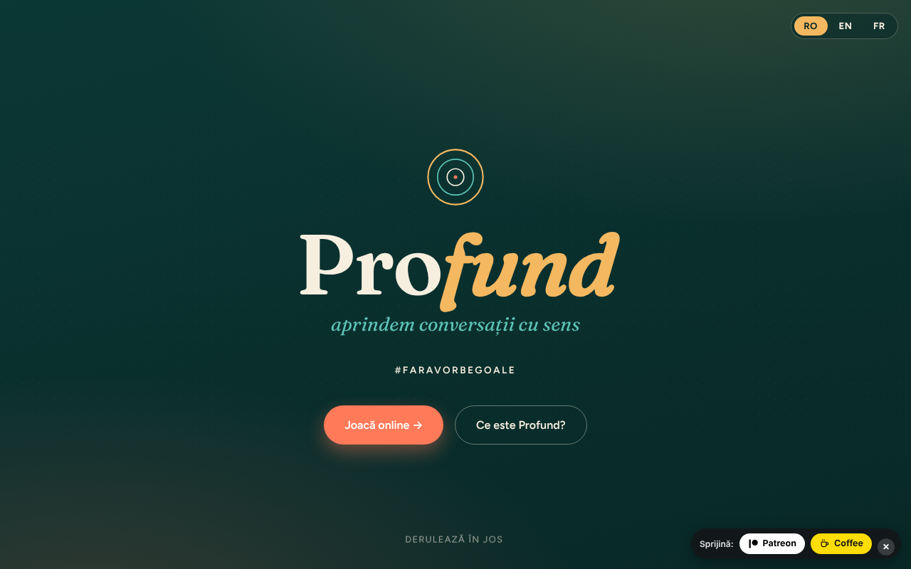

# Profund

[English](README.md) · **Română** · [Français](README.fr.md) · [Italiano](README.it.md) · [Español](README.es.md) · [Português](README.pt.md) · [Deutsch](README.de.md) · [Magyar](README.hu.md)

**Versiune:** 1.2.0 · **Ultima actualizare:** 2026-10-19

Limbile interfeței: **Română, English, Français, Italiano, Español, Português (PT), Deutsch, Magyar**

Joc de întrebări „fără-troc" (trade-free) pentru conversații cu sens — #FaraVorbeGoale.

**Live:** https://chiuta.github.io/Profund/

## Ce este

Profund este un joc de 150 de cărți cu întrebări care deschid conversații, într-un singur fișier HTML. Textul din aplicație îl descrie ca adaptare română / engleză / franceză după deepcards.org, proiect din ecosistemul TROM. Se poate juca online (cărți care se întorc la apăsare) sau offline, prin cărți tipărite.

## Funcții

- Interfață în 8 limbi (butoane RO / EN / FR / IT / ES / PT / DE / HU); cele 150 de întrebări există în română, engleză și franceză (celelalte limbi afișează varianta engleză).
- Prezentare: ce este jocul, cele trei idei ale lui și ce s-ar putea întâmpla.
- Patru moduri de joc descrise: „Ia & Răspunde" (2–6 persoane), „Ghicește" (2–6), „Declanșator de conversații" (4–20), „FărăRăspuns – TreciLaAcțiune" (2–10).
- Joc online: întrebările sunt în blocuri de câte 10; apeși pe o carte ca s-o întorci. Butoane „Carte la întâmplare", „Amestecă pachetul", „Următoarea carte".
- Jucători (opțional, doar în memorie): scrii numele separate prin virgulă și fiecare carte trasă arată, pe rând, cine răspunde.
- Scurtături de tastatură în zona „Joacă online": `Spațiu` sau `→` = următoarea carte, `R` = carte la întâmplare, `S` = amestecă (nu se activează în afara zonei de joc sau în câmpurile de text).
- Favorite și temporizator (în zona „Joacă online”): „♡ Păstrează cartea” marchează cartea trasă, iar „Descarcă favoritele (text)” salvează lista ca `profund-favorite.txt`; favoritele există doar în memorie, până la reîncărcarea paginii. Temporizatorul opțional (30 / 60 / 120 s) pornește la fiecare carte trasă și afișează „Timpul a expirat.” la final (fără sunet). Texte în RO / EN / FR.
- Joc offline: „Printează cărțile (PDF)" (150 de cărți, 3 pe rând, gata de decupat) și „Descarcă întrebările (text)".
- Formular de contact care pregătește un e-mail (mailto) către autor.

## Manual de utilizare

1. Alege limba din butoanele RO / EN / FR / IT / ES / PT / DE / HU din partea de sus.
2. Citește secțiunea „Moduri de joc" și alege unul.
3. La „Joacă online" apasă „Carte la întâmplare" pentru o carte, „Amestecă pachetul" pentru a amesteca, apoi „Următoarea carte". Când pachetul se termină, amestecă din nou.
4. Pentru joc fizic, la „Joacă offline" apasă „Printează cărțile (PDF)", alege „Salvează ca PDF" sau imprimă, apoi decupează cărțile.
5. „Descarcă întrebările (text)" salvează întrebările într-un fișier text.
6. La „Contact" completezi numele, e-mailul, subiectul și mesajul și apeși „Trimite mesajul": se deschide clientul tău de e-mail cu un mesaj către alexio@trom.tf (aplicația nu are server).

## Confidențialitate și rețea

- Local: se păstrează doar limba aleasă, în `localStorage` (cheia `profund_lang`).
- Rețea: nu am găsit apeluri `fetch`, scripturi sau fonturi externe (fonturile sunt integrate în fișier). Textul din aplicație afirmă „fără bani, fără date".
- Linkurile din subsol și cele de susținere (deepcards.org, tiotrom.com, trade-free.org, Buy Me a Coffee) se deschid doar dacă le apeși.
- Formularul de contact nu trimite date printr-un server; folosește `mailto:`.

## Rulare locală / offline

Descarcă `index.html` și deschide-l în browser; funcționează fără internet (linkurile externe necesită conexiune).

## Istoric / Changelog

### 1.1.0 — 2026-10-14
- Copie de rezervă și etichetare date (fff-kit).

### 12 octombrie 2026 (v1.0.0)
- 1.0.0 — 2026-10-12: versiunea și data ultimei actualizări sunt afișate în aplicație

### 11 octombrie 2026 (a treia intrare)
- Corectat titlul modului în engleză: „LetGuess” → „Guess” (cum sunt „Ghicește” în română și „Devine” în franceză).
- Favorite (descărcabile ca text) și temporizator opțional pe carte, în 3 limbi.

### 11 octombrie 2026 (a doua intrare)
- Politica CSP: `script-src` cu hash în loc de `'unsafe-inline'` (nu mai există atribute `on*` inline).
- Câmp opțional „Jucători" (rândul de răspuns pe carte trasă) și scurtături de tastatură; texte noi în RO / EN / FR.

### 11 octombrie 2026
- Accesibilitate: conținutul încadrat în <main>, selectorul de limbă ca <nav> etichetat (axe: 0 violări).
- Butoanele RO / EN / FR nu mai folosesc atribute `onclick` inline (ascultători de evenimente).

## Licență

Licență MIT — vezi fișierul LICENSE

## Drepturi și atribuire

- **Partea autorului:** codul aplicației și contribuția originală (adaptarea, traducerile RO/EN/FR, interfața). Licența MIT din antetul `index.html` și din `LICENSE` se aplică **doar** acestei părți.
- **Partea terților:** întrebările sunt adaptate după jocul de cărți [deepcards.org](https://deepcards.org/) (proiect din ecosistemul TROM; aplicația îl indică în subtitlu și în subsol). Originalele rămân ale titularilor lor; **licența MIT nu le acoperă**. Drepturile asupra materialelor terțe aparțin titularilor. Licența originalelor nu este verificată în acest repository.
- **Rectificare / retragere:** dacă ești titular de drepturi sau persoană menționată și dorești corectarea sau retragerea, scrie la alexio@trom.tf; răspundem în 7 zile.
- Nota este vizibilă și în aplicație (subsol, RO / EN / FR).

**NEREZOLVAT (doar autorul):** confirmarea că are (sau a obținut) dreptul de a publica întrebările adaptate în această formă ori indicarea licenței originalelor de la deepcards.org.

## Autor

Alexio — Alexandru-Ionuț Chiuță, contact: alexio@trom.tf. Aplicația îl menționează ca voluntar TROM.

## English summary

Profund ("Deep") is a single-file trade-free question card game (150 cards) for meaningful conversations, in Romanian, English and French. It offers four ways to play, an optional (memory-only) player list that shows whose turn it is to answer, keyboard shortcuts, an online card deck, print-to-PDF cards and a text download. Only the chosen language is stored in localStorage; no external requests were found, and the contact form uses mailto. Adapted from deepcards.org. The MIT License applies only to the code and the author's original contribution; the original questions remain with their rightsholders. Rectification/withdrawal requests: alexio@trom.tf (reply within 7 days).
